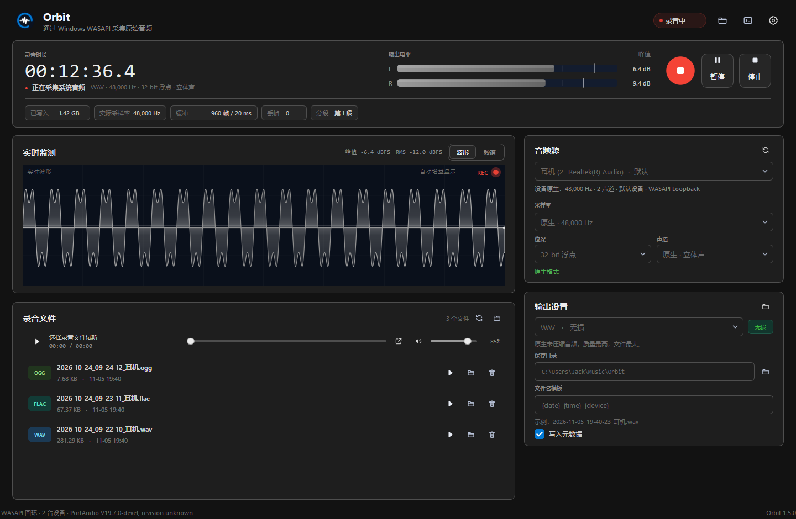
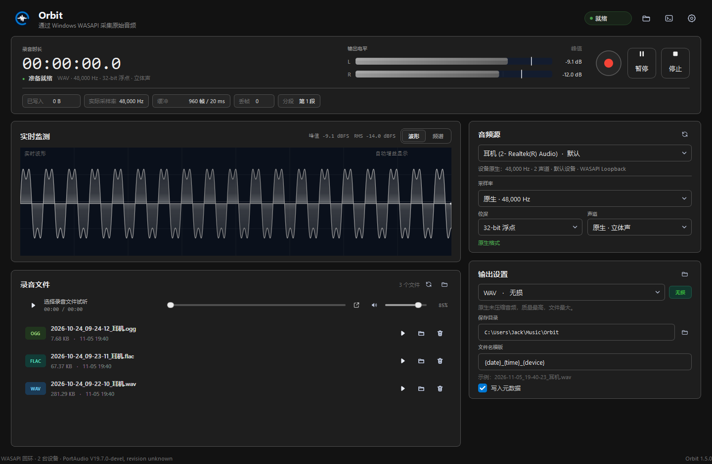
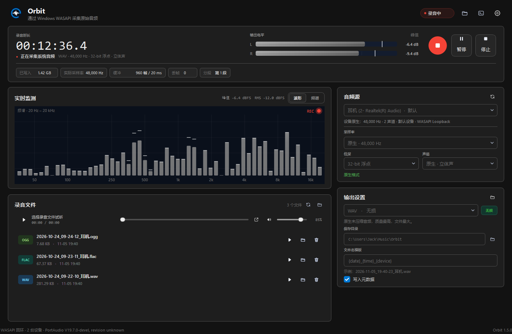
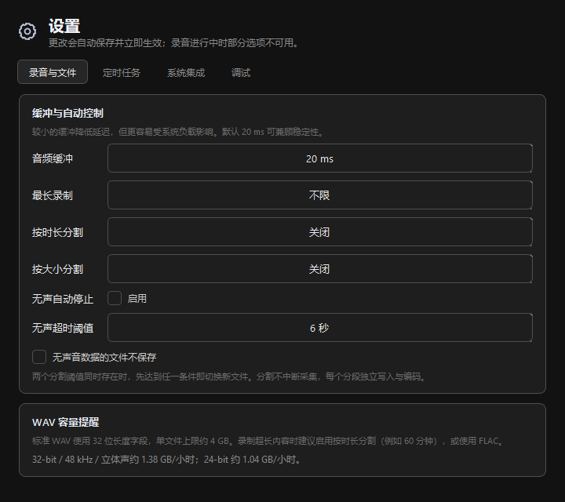
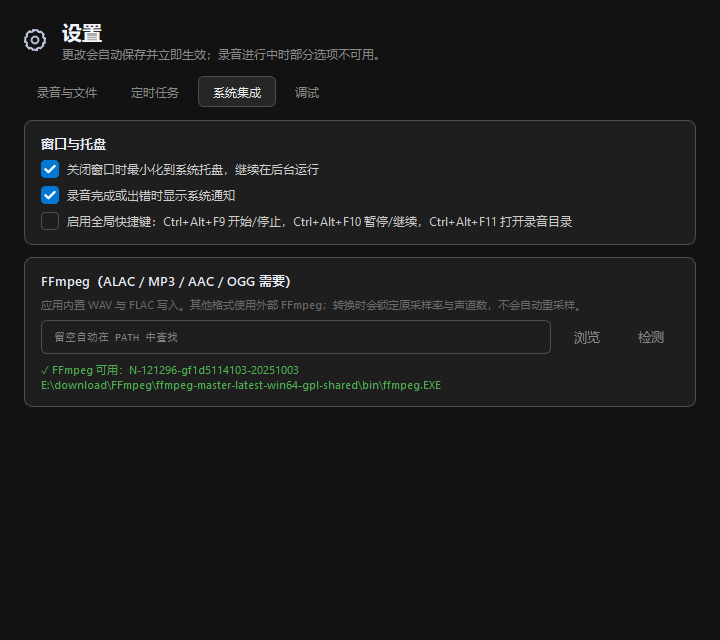
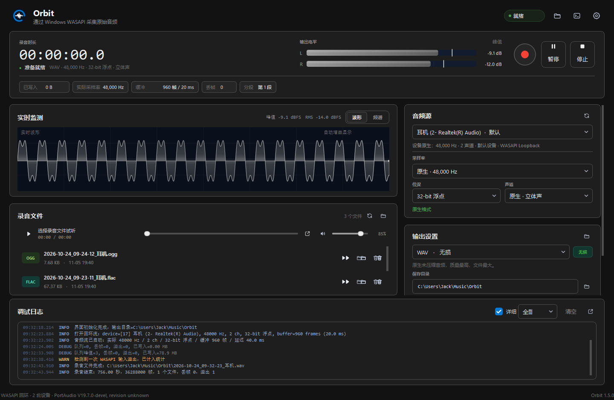
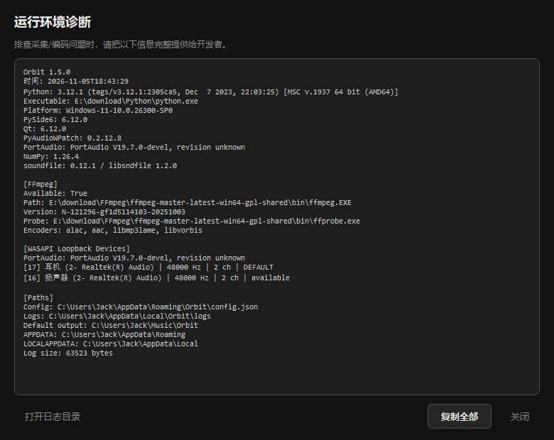

# Orbit

面向 Windows 的**系统声卡回环录音工具**。它采集电脑正在播放的声音（WASAPI Loopback），支持多种输出格式，旨在采集最原始的系统音频。默认使用设备原生采样率与 32-bit 浮点混音格式，避免应用层重采样和额外压缩。界面使用 PySide6 + 自绘控件，包含实时波形、频谱、双声道电平、文件试听、定时录制、自动分割、系统托盘与调试日志。

- **声明**：工具主要由**AI**通过DeepSeek Harness 0.2.1-rc2开发（主开发模型：DeepSeek-V4.1-Flash 1017、Qwen-3.8 flash，辅助模型Reflection Beam 1.0、NVIDIA Nemotron 3.5 Super VL）。开发者LCode参与了界面优化、功能调试测试、功能完善等。最终版权归LCode所有。
- **特别鸣谢**：zplb：[了解zplb](https://zplb.top "zplb个人主页")
- **开发者**：LCode：[了解LCode](https://l-code.top "LCode个人博客")
- **此工具以 Apache 2.0 协议开源，详见LICENSE文件**

---

## 主要特性

- **WASAPI采集**：基于 `PyAudioWPatch` 的 WASAPI Loopback 端点。
- **原始质量**：默认 `设备原生采样率 + 32-bit float + 原生声道数`；WAV 直接写入原始 PCM/Float 数据。
- **多种输出格式**：WAV、FLAC 应用内直接写入；ALAC、MP3、AAC、OGG 通过 FFmpeg 转码。
- **完整录音控制**：开始、暂停/继续、停止；暂停时间不计入录音时长。
- **实时监测**：峰值/RMS 电平表、滚动波形、对数频谱。**空闲（未录音）时也实时预览系统音频**，录音开始即自动让位给录音流；录制中波形与频谱右上角均显示呼吸红点 REC 指示。
- **详细调试信息**：日志面板、滚动日志文件、后端/PortAudio 版本、设备原生格式、实际采样率、缓冲大小、丢帧/溢出/队列统计。
- **自动分割与时长上限**：按分钟或 MB 自动切换新文件，达到最长时长自动停止。
- **每日定时录制**：到点自动开始；应用需保持运行，可最小化到托盘。
- **系统集成**：托盘运行、关闭到托盘、全局/局部快捷键、完成通知、单实例保护。
- **文件管理**：录音列表、试听（QtMultimedia，带音量/静音调节）、在资源管理器中定位、移至回收站、双击试听。
- **元数据**：标题、设备、日期、格式、软件版本；WAV RIFF INFO、FLAC Vorbis Comment、FFmpeg 输出标签。WAV 的 INFO 文本按系统 ANSI 代码页（简体中文=GBK）编码并 NUL 结尾，确保 Windows 资源管理器的"标题/作者/唱片集/备注"列正确显示中英文。
- **配置持久化**：`%APPDATA%\Orbit\config.json`；日志 `%LOCALAPPDATA%\Orbit\logs\app.log`。

---

## 界面展示

- **主界面（录音过程实时展示波形）**



- **空闲时实时监听系统音频**



- **录制时实时显示频谱**



- **设置界面**





- **调试日志**



- **运行环境诊断**



---

## 音质说明

本工具的目标是"尽量保留原始音频差异"，例如在"标准音质 / 全景声"之间切换时，确保录制结果能准确还原（源音频有明显区别时录音才有明显差异）。

**实现路径：**

1. 采集 Windows 共享混音端点的回环数据，采样率默认等于设备当前混音采样率（常见为 48,000 Hz）。
2. 默认以 **32-bit float** 读取，这是 Windows WASAPI 共享混音的原生浮点格式；选择 16/24-bit 时会显式量化为整数 PCM。
3. WAV 直接写入原始采样字节，不经过编码、重采样或音量处理。
4. FLAC 使用 24-bit 无损压缩；ALAC 使用 24-bit 无损编码；转码时向 FFmpeg 传入 `-ar` / `-ac` 锁定原采样率与声道数。
5. MP3、AAC（M4A）、OGG 使用 `ffmpeg` 转码，音质可能受损。

## 设计要点

- **采集线程与 GUI 分离**：PortAudio 回调只入队，不写磁盘；独立采集线程负责写文件和统计，所有 UI 更新通过 Qt 排队信号。
- **有界队列 + 丢帧统计**：磁盘短时抖动时吸收数据；队列满、PortAudio 输入溢出都会计数并在日志/指标中显示。
- **原子落盘**：写入 `.part` 临时文件，成功后 `os.replace`；WAV 在收尾时修补 RIFF 头、追加 LIST INFO；转码先写临时文件再替换。
- **失败保留数据**：转码失败时自动保留源 WAV，不会因编码器问题丢失录音。
- **设备热插拔**：后台定时扫描回环设备；录音中忽略设备枚举结果。采集中断/6 秒无回调会停止并保存，随后重新扫描。
- **不阻塞 UI**：设备扫描、采集、转码分别在后台线程；编码有进度信号。

### Windows 共享混音的边界

WASAPI Loopback 捕获的是 Windows 音频引擎的共享混音输出，不是某个应用在独占模式下直接送往声卡的比特流。因此：

- 若播放软件启用 **WASAPI 独占模式 / ASIO 独占**，其声音可能完全绕过共享混音，本工具无法采集；
- 源应用如果自己把音频重采样到系统混音格式，本工具无法恢复被源应用丢弃的采样；
- 设备原生采样率之外的采样率通常会被 PortAudio/WASAPI 拒绝（应用不会自动转换），UI 会给出错误提示；
- 本工具使用共享模式回环；PyAudioWPatch/PortAudio 没有暴露可靠的"独占模式回环"接口，因此没有提供独占选项。

在 **设备、Windows 混音格式、源应用输出格式一致** 的前提下，32-bit float WAV 可以原样保留共享混音端点的浮点数据；24-bit FLAC/ALAC 则是对该信号做 24-bit 量化后的无损压缩，量化误差约 -144 dBFS，远低于可听范围。

---

## 环境要求

| 组件 | 要求 |
| --- | --- |
| 操作系统 | Windows 11（Windows 10 21H2+ 也可运行） |
| Python | 3.10+（本项目在 3.12.1 实测） |
| GUI | PySide6 6.8+（实测 6.10.3） |
| 回环后端 | PyAudioWPatch 0.2.12.8+（PortAudio 19.7） |
| 无损/标签 | soundfile 0.12.1+ / mutagen 1.47+ |
| 转码（可选） | FFmpeg，需包含 `alac`、`aac`、`libmp3lame`、`libvorbis` 编码器 |

FFmpeg 仅用于 ALAC / MP3 / AAC / OGG。WAV 和 FLAC 不依赖 FFmpeg。

---

## 安装

### 方式一：批处理（推荐）

双击 `install.bat`。它会调用当前 PATH 中的 `python` / `pip`，安装 `requirements.txt` 中的依赖，并检测 FFmpeg。

### 方式二：手动

文档目前不提供python虚拟环境安装方法，可以自行尝试。以下提供全局python安装方法：

```bash
cd /d "<Orbit根目录绝对路径>"
python -m pip install --upgrade pip
python -m pip install -r requirements.txt
```

**注意**：指令 `cd /d "<Orbit根目录绝对路径>"` 中 `<Orbit根目录绝对路径>` 是项目根目录路径，该路径下包含run.py、requirements.txt等文件，需替换为实际路径。为保证指令正确执行，建议将路径中的"\\"替换为"\\\\"。例如：根目录处于E:\\下载\\Orbit，则指令为 `cd /d "E:\\\\下载\\\\Orbit"`。

如果系统 Python 的 `site-packages` 不可写，pip 会自动安装到当前用户目录；这是正常的。

### 方式三：pip 安装（可选，适合开发者）

安装到当前 Python 环境，之后可在任意目录用 `orbit` 命令启动：

```bash
cd /d "<Orbit根目录绝对路径>"
python -m pip install -e .
orbit
orbit --diagnose
orbit --version
```

`-e` 为开发模式，代码修改实时生效。卸载：`python -m pip uninstall orbit`。

### 安装 FFmpeg（ALAC / 有损格式需要）

任选一种：

- 下载 Windows 版 FFmpeg，将FFmpeg根目录下的 `bin` 目录加入环境变量 `PATH`；
- 源码运行时，也可把 `ffmpeg.exe` 放到项目下的 `tools\\ffmpeg\\bin\\ffmpeg.exe`；
- 或在应用内打开 **设置 → 系统集成 → FFmpeg**，手动选择 `ffmpeg.exe`。

验证：

```bash
ffmpeg -version
ffmpeg -hide_banner -encoders | findstr /i "alac aac libmp3lame libvorbis"
```

---

## 启动

| 方式 | 命令/文件 | 说明 |
| --- | --- | --- |
| **日常启动（推荐）** | 双击 run.pyw | 通过 pythonw 运行，无控制台窗口；run.py运行报错时直接退出，run.pyw报错会弹窗提示 |
| 调试启动 | 双击 `start.bat` 或 `run.py` | 保留控制台，便于查看异常输出（程序内日志） |
| pip安装后 | `python -m orbit` 或 `orbit` | 适合开发调试；`--diagnose` 会打印 WASAPI 回环设备、设备原生采样率/声道、FFmpeg 路径与编码器支持情况 |

> 本项目**不提供独立 EXE**：程序直接随 Python 源码运行，依赖装在系统 Python 环境里，避免打包环境带来的兼容性风险。换电脑使用时，复制整个项目目录、先运行一次 `install.bat`，再双击 `run.pyw` 即可。FFmpeg 不随项目分发，ALAC/有损格式仍需系统 PATH 或设置中指定。

首次启动会创建配置和日志目录，并扫描 WASAPI 回环设备。

---

## 快速上手

1. **音频源**：选择播放设备对应的回环端点，默认设备会带"默认"标记。
2. **采样率/位深/声道**：建议保持"原生"和高位深。默认是设备原生率 + 32-bit float。
3. **输出设置**：选择 WAV/FLAC 等格式，设置保存目录与文件名模板。
4. 点击红色录音按钮，播放音乐，观察电平、波形和频谱。
5. 点击暂停/继续或停止；文件完成后会出现在"录音文件"列表，可双击试听。
6. 试听条右侧有**音量滑块与静音按钮**，仅调节应用内试听音量，不影响录音，也会记住设置。

文件名模板支持：

```text
{date} {time} {datetime} {device} {format}
{sample_rate} {bit_depth} {channels} {part}
```

示例：`2026-10-24_09-32-23_耳机.wav`。同名文件自动追加 `(2)`、`(3)`，不会覆盖。

---

## 输出格式

| 格式 | 类型 | 位深 | 依赖 | 说明 |
| --- | --- | --- | --- | --- |
| WAV | 无损 | 16 / 24 / 32f | 无 | 原始 PCM/Float，质量最高、体积最大；单文件约 4 GB 上限 |
| FLAC | 无损 | 16 / 24 | soundfile | 无损压缩，通用性好，适合长时间保存 |
| ALAC (M4A) | 无损 | 16 / 24 | FFmpeg | Apple 无损，适合 Apple 生态 |
| MP3 | 有损 | 16 / 24 输入 | FFmpeg | 通用有损，320 kbps 默认 |
| AAC (M4A) | 有损 | 16 / 24 输入 | FFmpeg | 高效有损，适合移动端 |
| OGG Vorbis | 有损 | 16 / 24 输入 | FFmpeg | 开放有损格式 |

> 有损格式在首次开始录音时会弹出确认，并在输出设置中持续显示"有损"警告。

### WAV 4 GB 限制

标准 RIFF WAV 的长度字段是 32 位，单个文件约 4 GB。应用在接近上限时会停止并保存已有数据。超长录制建议：

- 使用 FLAC；或
- 在 **设置 → 录音与文件** 中启用按时长/大小自动分割。

---

## 自动化与快捷键

| 快捷键 | 功能 |
| --- | --- |
| `F9` | 开始录音 / 停止录音 |
| `F10` | 暂停 / 继续 |
| `F11` | 打开录音目录 |
| `Ctrl+,` | 打开设置 |
| `Ctrl+Alt+F9` | 全局：开始/停止（可选开启） |
| `Ctrl+Alt+F10` | 全局：暂停/继续（可选开启） |
| `Ctrl+Alt+F11` | 全局：打开录音目录（可选开启） |

全局快捷键使用 Win32 `RegisterHotKey`，被其他程序占用时会提示；可在设置中关闭。

### 每日定时录制

在 **设置 → 定时任务** 中启用，选择开始时间。应用需保持运行，建议关闭窗口时最小化到托盘。到点若已有录音，则本次跳过；最长录制时间与自动分割仍然生效。

### 自动分割

在 **设置 → 录音与文件** 中设置"按时长分割"和/或"按大小分割"。达到任一阈值时，采集不中断，当前分段封存并开始新文件；使用转码格式时分段会由后台单线程依次编码。无损 WAV 的大小阈值较精确，压缩/转码格式为近似值。

---

## 调试与日志

- 点击标题栏右侧终端图标显示/隐藏调试面板。
- 面板可过滤 `全部 / 信息 / 警告 / 错误`；设为"全部"可查看 DEBUG 级细节。
- 日志文件：`%LOCALAPPDATA%\Orbit\logs\app.log`，4 MB × 5 滚动。
- 设置 → 调试 → **运行环境诊断** 可查看 Python、Qt、PortAudio、设备、FFmpeg 编码器、路径，并一键复制。

### 命令行诊断

```bash
python run.py --diagnose
python run.py --version
python run.py --reset-config
python run.py --no-single-instance
orbit --version
orbit --diagnose
```

`orbit` 有关指令需要通过pip安装后才能使用
`--diagnose` 会打印 WASAPI 回环设备、设备原生采样率/声道、FFmpeg 路径与编码器支持情况。
`--reset-config` 会备份现有配置（`config.json` → `config.backup-<时间戳>.json`）并重置为默认值，用于配置损坏或迁移失败时恢复。
`--no-single-instance` 为开发调试选项，跳过单实例互斥锁，允许同时运行多个实例（也可通过环境变量 `ORBIT_MULTI=1` 等价开启）。

> 控制台输出：`run.py` 保留控制台；`run.pyw` 无控制台。pip 安装的 `orbit` 命令在无父控制台时（双击运行）会自动派生新的 cmd 窗口显示输出。如需强制 UTF-8 输出，可设置 `PYTHONUTF8=1`。

---

## 常见问题

- **没有可用的回环设备**

- 确认至少有一个播放设备已启用，并且不是"已禁用/已拔出"状态；
- 在 Windows 声音设置中允许应用访问音频设备；
- 点击"音频源"右上角刷新，或重新插入耳机/扬声器；
- 某些虚拟声卡驱动不会暴露回环端点。

- **点击开始后提示"采样率不支持"**

Windows 共享回环通常只接受设备当前混音采样率（例如 48,000 Hz）。选择"原生 · 48,000 Hz"即可；本应用不会为了启动而自动重采样。

- **ALAC/MP3/AAC/OGG 提示需要 FFmpeg**

在设置中指定 `ffmpeg.exe`，或先改用 WAV/FLAC。可以用 `--diagnose` 检查编码器是否存在。转码失败时，原始 WAV 会以 `*_source.wav` 保留，录音数据不会丢失。

- **为什么录音里没有某个应用的声音？**

该应用可能启用了 WASAPI 独占/ASIO 独占，绕过了 Windows 共享混音；这种音频无法通过回环端点采集。

- **没有声音但电平表在动？**

本工具采集的是系统播放输出，不是麦克风；请确认音乐软件正在向当前选中的播放设备输出。

- **关闭窗口后程序还在运行？**

默认关闭到系统托盘。双击托盘图标恢复，或在托盘菜单中选择"退出"。可在设置中关闭此行为`设置 → 系统集成 → 窗口与托盘`。

- **杀毒软件拦截全局热键/托盘**

这些是可选功能，关闭后不影响录音。所有录音写入均为普通文件操作。

---

## 项目结构

```text
Orbit_windows/
├─ orbit/
│  ├─ __init__.py             # 包入口，导出 __version__
│  ├─ __main__.py             # python -m orbit 入口
│  ├─ app.py                  # 应用入口、单实例、CLI 诊断、深色标题栏
│  ├─ config.py               # 配置模型与原子持久化
│  ├─ constants.py            # 应用名、版本、WAV 上限、扩展名等常量
│  ├─ logging_setup.py        # 滚动日志 + Qt 日志桥
│  ├─ models.py               # 设备/请求/结果数据类
│  ├─ audio/
│  │  ├─ devices.py           # WASAPI 回环设备扫描（后台线程）
│  │  ├─ monitor.py           # 空闲实时监听
│  │  ├─ formats.py           # 格式、位深、采样率能力定义
│  │  ├─ portaudio.py         # PortAudio 跨线程串行化与流占用交接
│  │  ├─ recorder.py          # 采集线程、队列、分段、统计
│  │  ├─ sinks.py             # WAV 写入、FLAC 流式写入
│  │  ├─ analysis.py          # PCM 解码、电平/频谱
│  │  ├─ ffmpeg.py            # 编码器探测、转码、ffprobe
│  │  └─ metadata.py          # FLAC 标签
│  ├─ ui/
│  │  ├─ main_window.py       # 主窗口、状态机、文件/托盘/日程
│  │  ├─ widgets.py           # 电平表、波形、频谱、播放条等
│  │  ├─ settings.py          # 设置与诊断对话框
│  │  └─ theme.py             # 颜色、QSS、图标、深色标题栏
│  ├─ util/
│  │  ├─ exit_guard.py        # 退出看门狗（卡死时强制结束）
│  │  ├─ hotkeys.py           # 全局快捷键（Win32 RegisterHotKey）
│  │  ├─ naming.py            # 文件名模板与非法字符处理
│  │  ├─ paths.py             # 路径、文件大小、系统外壳打开
│  │  └─ shell.py             # 回收站移除（SHFileOperationW）
│  └─ assets/
│     ├─ app.ico / app.png    # 应用图标
│     └─ icons/*.svg          # 19 个界面 SVG 图标
├─ tests/                     # pytest 单元测试（29 个）
├─ tools/                     # 开发期诊断与截图脚本
│  ├─ capture_all.py          # 生成全套深色主题截图（含录音态/频谱/日志）
│  ├─ check_runpyw.py         # run.pyw 端到端启动→录音→校验→退出
│  ├─ probe_*.py              # 真实设备/格式/录音/监听/热键/交接等探测
│  ├─ screenshot_settings.py  # 设置/诊断对话框截图
│  └─ screenshot_ui.py        # 旧版界面截图脚本
├─ docs/                      # README 截图（8 张，深色主题）
├─ .vscode/settings.json      # VS Code Python 环境配置
├─ .gitignore
├─ pyproject.toml             # 打包/依赖/入口点（pip install -e .）
├─ pytest.ini                 # pytest 配置（testpaths=tests）
├─ requirements.txt           # 运行时依赖
├─ requirements-dev.txt       # 开发依赖（pytest/ruff/pyinstaller/sounddevice）
├─ run.py                     # 源码运行入口（保留控制台）
├─ run.pyw                    # 日常启动入口（pythonw，无控制台）
├─ install.bat / start.bat    # 安装 / 调试启动脚本
└─ ...
```

---

## 验证结果（开发环境本机实测）

在 Windows 11 + Python 3.12.1 + Realtek 48 kHz 立体声回环端点上完成：

- 成功启动并枚举到 2 个 WASAPI 回环设备；
- 播放 997 Hz 测试音，采集得到 48,000 Hz / 2 ch / 32-bit float WAV，峰值频率 **996.85 Hz**，峰值约 **0.23**，**丢帧 0、溢出 0**；
- 源码版验证了 WAV/FLAC/ALAC/MP3/AAC/OGG 全格式输出，ALAC 为 24-bit 无损，MP3/AAC/OGG 采样率保持 48 kHz；
- 暂停/继续、无效设备错误处理、最长时长、自动分割（4 段）、全局热键注册、托盘关闭/恢复、配置原子保存均已实测。

---

## 测试

```bash
python -m pip install -r requirements-dev.txt
python -m pytest
```

当前包含 29 个单元测试，覆盖：

- WAV 16/24/32f 写入与元数据（含 GBK+NUL 编码规则）；
- FLAC 24-bit 精度与标签；
- 24-bit 符号扩展、电平、频谱；
- 文件名模板/非法字符/同名递增；
- 配置归一化、原子保存、损坏备份；
- 采样率/格式能力校验；
- 日志文件不可写时的降级与备用日志清理；
- PortAudio 流占用登记与释放（防计数泄漏、等待交接）。

开发期实测脚本（会访问真实音频设备）：

```bash
python tools\capture_all.py          # 生成全套深色主题截图（8 张）
python tools\screenshot_settings.py  # 设置/诊断对话框截图
python tools\screenshot_ui.py        # 旧版界面截图脚本
python tools\probe_sinks.py           # WAV/FLAC 写入
python tools\probe_ffmpeg.py          # ALAC/MP3/AAC/OGG 转码
python tools\probe_recorder.py        # 真实回环录音（各格式）
python tools\probe_audio_quality.py   # 播放测试音并检查频率/电平
python tools\probe_recorder_split.py  # 自动分割/最长时长/无效设备
python tools\probe_formats_capture.py # 16-bit / 单声道 / 非原生采样率
python tools\probe_player.py          # QtMultimedia 试听各格式
python tools\probe_volume.py          # 试听音量滑块/静音/配置持久化
python tools\probe_monitor.py         # 空闲实时监听与录制红点
python tools\probe_hotkeys.py         # 全局热键注册与 WM_HOTKEY 处理
python tools\probe_handoff.py         # 监听↔录音设备交接（流占用/释放，多轮）
python tools\check_runpyw.py          # run.pyw 端到端：启动→录音→校验→干净退出
```

`probe_*` 会访问真实声卡和输出目录，建议在无人使用电脑时运行。

---

## 已知限制

- 仅支持 Windows（Windows 10 +）；WASAPI Loopback 无法在 Linux/Mac 实现。
- 无法捕获独占模式/ASIO 独占应用的音频。
- 共享回环可选的采样率通常只有设备当前混音率；非原生率会被拒绝而不是重采样。
- `PyAudioWPatch` 提供的 PortAudio 流不支持"独占模式回环"。
- QtMultimedia 的试听解码能力取决于 Qt 自带的 FFmpeg 后端；ALAC/OGG 等已在当前环境实测可试听。
- 设备热插拔采用轮询 + 回调看门狗，极端驱动异常时可能需要手动刷新设备。

---
